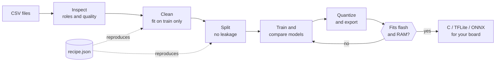
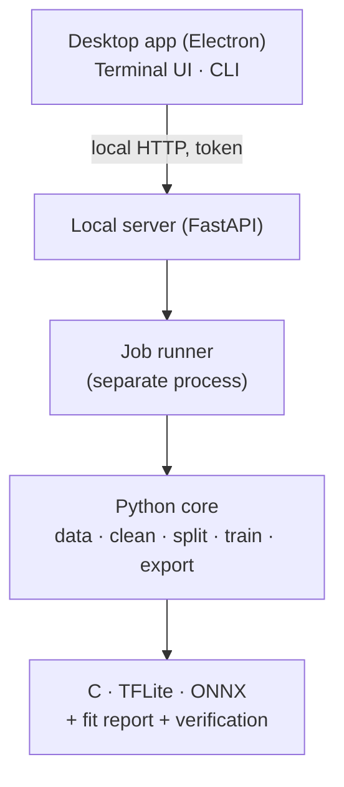

<div align="center">

<b>English</b> · <a href="docs/translations/README.es.md">Español</a> · <a href="docs/translations/README.ja.md">日本語</a> · <a href="docs/translations/README.fr.md">Français</a> · <a href="docs/translations/README.pt-BR.md">Português (Brasil)</a> · <a href="docs/translations/README.ko.md">한국어</a> · <a href="docs/translations/README.zh-CN.md">简体中文</a> · <a href="docs/translations/README.de.md">Deutsch</a> · <a href="docs/translations/README.it.md">Italiano</a> · <a href="docs/translations/README.ru.md">Русский</a>

# TinyML Studio

### Turn sensor data into a model that fits your microcontroller.

<p>Clean your data, train and compare models, quantize and export C, TFLite or ONNX, and check that it fits your board <b>before</b> you flash anything.</p>

<p><i>It is not limited to one kind of data: Any table of numbers works (sensors, machines, environment, wearables, surveys). The two hardware examples below are just tests: One is a student survey, the other uses electrical readings.</i></p>


<p><a href="#download">Download</a> · <a href="#quick-start">Quick start</a> · <a href="#how">How it works</a> · <a href="#verified">Verified on hardware</a> · <a href="#license">License</a></p>

</div>

> Pre-release (v0.0.x). Verified on a PC (Windows 11 and Linux) and on an ESP32-S3 with two small examples. See what is and is not verified below.

<a id="why"></a>
## Why it exists
- Going from a CSV to a microcontroller usually means stitching notebooks, converters and hand-written C together, and finding out at the end that it does not fit or does not behave like the Python model.
- Every step here is saved in a reproducible JSON recipe, fitted on training data only (no leakage), and the exported model is compared with the original.
- The app tells you plainly what was measured and what was only estimated.

<a id="how"></a>
## How it works
Seven guided steps, from your CSV files to code you can paste into your board's project.



1. <b>Dataset</b>: Open one or many CSV files; the app checks they can be mixed.
2. <b>Task</b>: Choose what to predict and the role of each column.
3. <b>Cleaning</b>: Missing and absurd values, scaling. Every step is fitted on train only.
4. <b>Augmentation</b> (optional): Create new training rows from your real rows. At your own responsibility.
5. <b>Split</b>: Train, validation and test without leaking neighbouring rows; optional class balancing.
6. <b>Model and training</b>: Compare classical models and small networks on identical splits.
7. <b>Board and export</b>: Quantize, check flash and RAM, and get C code, TFLite or ONNX.

### Architecture
A Python core does the machine learning, a small local server exposes it, and the desktop app (Electron) is only the interface. The terminal UI and the command line use the same core.



## Features
| | |
|---|---|
| **Data** | Many CSV files, InfluxDB exports, decimal commas and latin-1. Warns when files should not be mixed. |
| **Honest evaluation** | Leave-one-session-out validation, permutation importance, unknown-class rejection and anomaly detection. The test set is used once. |
| **Models** | scikit-learn models, Keras MLP and 1D-CNN with TensorFlow or PyTorch, benchmark with cross-validation and a search under your flash and RAM budget. |
| **Verified export** | Standalone C for classical models, TFLite (float, int8, float16) and ONNX, always checked against the original model. |
| **Boards** | Sheets for ESP32-S3 and other ESP32, Arduino, Raspberry Pi and STM32 boards, each field with its source. |
| **Hardware** | Uses your NVIDIA or AMD GPU when available, shows load and temperature while training, three interfaces (desktop, terminal, CLI). |

## What it can train and export
Supervised learning (classification and regression) and unsupervised anomaly detection. The app suggests the task from your columns and you confirm it.

| | |
|---|---|
| **Tasks** | Classification and regression, anomaly detection without labels (Isolation Forest, One-Class SVM) trained on normal data only, and unknown-class rejection so the model can answer "I do not know". Clustering is not included. |
| **Models** | Classical: Decision tree, random forest, extra trees, gradient boosting, logistic and linear regression, Lasso, Elastic Net, LDA, linear SVM, SVM and SVR, k-NN, Gaussian Naive Bayes, MLP. Neural: Keras MLP and 1D-CNN over windows of consecutive rows, with a TensorFlow or PyTorch backend. |
| **Cleaning and augmentation** | Imputation, absurd values, outliers (IQR or z-score), scaling (standard, min-max, robust), duplicates and filters. Optional augmentation of training rows with Gaussian noise or SMOTE-style interpolation. Everything is fitted on train only. |
| **Split and evaluation** | Random, stratified, by group or temporal blocks, with optional class balancing. Cross-validated benchmark, hyperparameter search under your flash and RAM budget, permutation importance. The test set is used once. |
| **Export** | Dependency-free C99 (linear models, trees and forests, SVM, MLP, Naive Bayes, plus a compact layout for forests), TFLite (float, int8, float16), ONNX and Arduino sketches. Not every model exports everywhere: The app tells you which ones do. |
| **Checks** | Fit report for flash and RAM per board, Keras against TFLite against int8 comparison, and test vectors that check the C code against Python. Latency is an estimate, not a measurement. |

<a id="verified"></a>
## Verified on hardware
Two small, real examples have been run end to end on an ESP32-S3. They show that the pipeline works; they are not benchmarks.

| Example | On the computer | On the ESP32-S3 |
|---|---|---|
| Regression: Exam score from a student survey (public dataset, 6,607 rows) | R² 0.943 on the held-out test split; generated C equals scikit-learn on 100 % of 656 test vectors | 6 of 6 survey cases match Python (for example 72.1 against 72.12); 22 % of the board's program flash |
| Classification: Tell two household fans apart from four electrical readings | F1 macro 1.000 on the test split (two recordings, so this is not proof of generalization); C equals Python on 100 % of vectors | 6 of 6 steady live readings correct; a transient while switching fans was misclassified |

<b>Not verified:</b> Other boards, measured latency and power (latency figures are estimates), AMD GPU training, macOS, other appliances or other days for the classification example, and the generated Arduino sketches in every Arduino IDE version.

<a id="download"></a>
## Download and run
Installers are published on the <b>Releases</b> page. No Python or Node.js is needed to try the app. Windows installers are unsigned, so SmartScreen may warn you ("More info", then "Run anyway").

| Platform | File |
|---|---|
| Windows 10 / 11 | Setup <code>.exe</code> or <code>.zip</code> |
| Linux | <code>.AppImage</code> or <code>.deb</code> |

<a id="quick-start"></a>
### Build from source
```bash
pip install -e ".[dev]"             # core + tests
python -m tinyml_studio.cli --help  # command line
cd ui && npm install && npm start   # desktop app (Python 3.10+, Node.js 20+)
```

## Documentation
User manual (PDF, English, with screenshots): <a href="docs/manual/TinyML-Studio-User-Manual.pdf">docs/manual</a>.

## Contributing
Issues and pull requests are welcome, especially validation on real boards (please report board, toolchain and results), new board sheets with sources, translations and new exporters. Run <code>ruff check .</code> and <code>pytest</code> before opening a pull request.

<a id="license"></a>
## License
Free software under the <b>GNU General Public License v3.0</b> (see <a href="LICENSE">LICENSE</a>). You may use, study, modify and redistribute it; distributed derivative works must stay open under the same license. Dependencies keep their own licenses.

## Your models and generated code
The models you train and the code and files TinyML Studio generates for your projects (C, TFLite, ONNX, Arduino sketches) belong to you. You may use them under any license, including in closed products. The GPL-3.0 covers the application itself, not what you make with it.

## Credits
Copyright © 2026 BrianGTRxx. Designed and directed by the author and <b>developed with the assistance of Claude</b> (Anthropic). See <a href="AUTHORS.md">AUTHORS.md</a>.
