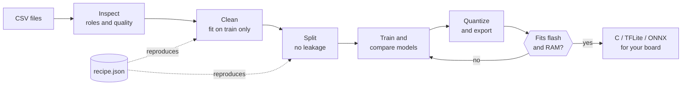
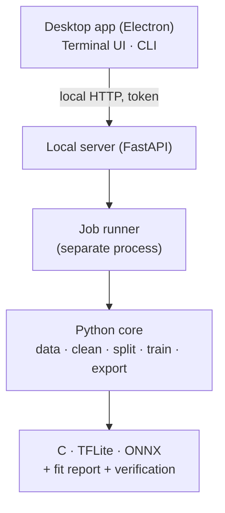

<div align="center">

<a href="../../README.md">English</a> · <a href="README.es.md">Español</a> · <a href="README.ja.md">日本語</a> · <a href="README.fr.md">Français</a> · <a href="README.pt-BR.md">Português (Brasil)</a> · <a href="README.ko.md">한국어</a> · <a href="README.zh-CN.md">简体中文</a> · <b>Deutsch</b> · <a href="README.it.md">Italiano</a> · <a href="README.ru.md">Русский</a>

# TinyML Studio

### Verwandelt Sensordaten in ein Modell, das auf Ihren Mikrocontroller passt.

<p>Daten bereinigen, Modelle trainieren und vergleichen, quantisieren und als C, TFLite oder ONNX exportieren und prüfen, ob es auf Ihr Board passt, <b>bevor</b> Sie etwas flashen.</p>

<p><i>Sie ist nicht auf eine Datenart beschränkt: Jede Zahlentabelle funktioniert (Sensoren, Maschinen, Umwelt, Wearables, Umfragen). Die beiden Hardware-Beispiele unten sind nur Tests: Eines ist eine Schülerumfrage, das andere nutzt elektrische Messwerte.</i></p>


<p><a href="#download">Download</a> · <a href="#quick-start">Schnellstart</a> · <a href="#how">So funktioniert es</a> · <a href="#verified">Auf Hardware geprüft</a> · <a href="#license">Lizenz</a></p>

</div>

> Vorabversion (v0.0.x). Auf dem PC (Windows 11 und Linux) und mit zwei kleinen Beispielen auf einem ESP32-S3 geprüft. Was geprüft ist und was nicht, steht weiter unten.

> 🌐 Diese Übersetzung entstand mit KI-Unterstützung. Korrekturen per Pull Request sind willkommen.

<a id="why"></a>
## Wozu das Ganze
- Vom CSV zum Mikrocontroller bedeutet meist, Notebooks, Konverter und handgeschriebenes C zusammenzufügen und am Ende festzustellen, dass es nicht passt oder sich anders verhält als das Python-Modell.
- Hier wird jeder Schritt in einem reproduzierbaren JSON-Rezept gespeichert, nur mit Trainingsdaten angepasst (kein Datenleck), und das exportierte Modell wird mit dem Original verglichen.
- Die App sagt klar, was gemessen und was nur geschätzt wurde.

<a id="how"></a>
## So funktioniert es
Sieben geführte Schritte, von Ihren CSV-Dateien bis zu Code, den Sie in das Projekt Ihres Boards einfügen können.



1. <b>Datensatz</b>: Eine oder mehrere CSV-Dateien öffnen; die App prüft, ob sie zusammengeführt werden dürfen.
2. <b>Aufgabe</b>: Zielgröße und Rolle jeder Spalte festlegen.
3. <b>Bereinigung</b>: Fehlende und absurde Werte, Skalierung. Jeder Schritt wird nur auf den Trainingsdaten angepasst.
4. <b>Augmentierung</b> (optional): Neue Trainingszeilen aus Ihren echten Zeilen erzeugen. Auf eigene Verantwortung.
5. <b>Aufteilung</b>: Training, Validierung und Test ohne Durchsickern benachbarter Zeilen; optionaler Klassenausgleich.
6. <b>Modell und Training</b>: Klassische Modelle und kleine Netze auf identischen Aufteilungen vergleichen.
7. <b>Board und Export</b>: Quantisieren, Flash und RAM prüfen und C-Code, TFLite oder ONNX erhalten.

### Architektur
Ein Python-Kern übernimmt das maschinelle Lernen, ein kleiner lokaler Server stellt ihn bereit, und die Desktop-App (Electron) ist nur die Oberfläche. Die Terminal-Oberfläche und die Kommandozeile nutzen denselben Kern.



## Funktionen
| | |
|---|---|
| **Daten** | Mehrere CSV-Dateien, InfluxDB-Exporte, Dezimalkomma und latin-1. Warnt, wenn Dateien nicht zusammengehören. |
| **Ehrliche Auswertung** | Leave-one-session-out-Validierung, Permutationswichtigkeit, Zurückweisung unbekannter Klassen und Anomalieerkennung. Der Testdatensatz wird nur einmal verwendet. |
| **Modelle** | scikit-learn-Modelle, Keras-MLP und 1D-CNN mit TensorFlow oder PyTorch, Benchmark mit Kreuzvalidierung und Suche innerhalb Ihres Flash- und RAM-Budgets. |
| **Geprüfter Export** | Eigenständiges C für klassische Modelle, TFLite (float, int8, float16) und ONNX, immer gegen das Originalmodell geprüft. |
| **Boards** | Datenblätter für ESP32-S3 und weitere ESP32, Arduino, Raspberry Pi und STM32, jedes Feld mit Quelle. |
| **Hardware** | Nutzt Ihre NVIDIA- oder AMD-GPU, falls vorhanden, zeigt Last und Temperatur beim Training, drei Oberflächen (Desktop, Terminal, CLI). |

<a id="verified"></a>
## Auf Hardware geprüft
Zwei kleine, echte Beispiele wurden vollständig auf einem ESP32-S3 ausgeführt. Sie zeigen, dass die Kette funktioniert; es sind keine Benchmarks.

| Beispiel | Auf dem Computer | Auf dem ESP32-S3 |
|---|---|---|
| Regression: Prüfungsnote aus einer Schülerumfrage (öffentlicher Datensatz, 6.607 Zeilen) | R² 0,943 auf dem zurückgehaltenen Test; der erzeugte C-Code stimmt bei 100 % von 656 Testvektoren mit scikit-learn überein | 6 von 6 Umfragefällen stimmen mit Python überein (z. B. 72,1 gegenüber 72,12); 22 % des Programm-Flash |
| Klassifikation: Zwei Haushaltsventilatoren anhand von vier elektrischen Messwerten unterscheiden | F1 macro 1,000 im Test (zwei Aufnahmen, also kein Beleg für Verallgemeinerung); C stimmt bei 100 % der Vektoren mit Python überein | 6 von 6 stabilen Live-Messungen korrekt; ein Übergangszustand beim Wechsel der Ventilatoren wurde falsch klassifiziert |

<b>Nicht geprüft:</b> Andere Boards, gemessene Latenz und Leistungsaufnahme (Latenzwerte sind Schätzungen), Training auf AMD-GPUs, macOS, andere Geräte oder andere Tage im Klassifikationsbeispiel sowie die erzeugten Arduino-Sketche in allen Versionen der IDE.

<a id="download"></a>
## Herunterladen und starten
Installationsprogramme erscheinen auf der Seite <b>Releases</b>. Zum Ausprobieren braucht man weder Python noch Node.js. Die Windows-Installer sind nicht signiert, daher kann SmartScreen warnen („Weitere Informationen“, dann „Trotzdem ausführen“).

| Plattform | Datei |
|---|---|
| Windows 10 / 11 | Setup <code>.exe</code> oder <code>.zip</code> |
| Linux | <code>.AppImage</code> oder <code>.deb</code> |

<a id="quick-start"></a>
### Aus dem Quellcode bauen
```bash
pip install -e ".[dev]"             # core + tests
python -m tinyml_studio.cli --help  # command line
cd ui && npm install && npm start   # desktop app (Python 3.10+, Node.js 20+)
```

## Dokumentation
Benutzerhandbuch (PDF, Englisch, mit Screenshots): <a href="../manual/TinyML-Studio-User-Manual.pdf">docs/manual</a>.

## Mitwirken
Issues und Pull Requests sind willkommen, besonders Prüfungen auf echten Boards (bitte Board, Toolchain und Ergebnisse angeben), neue Board-Datenblätter mit Quellen, Übersetzungen und neue Exporter. Führen Sie vor einem Pull Request <code>ruff check .</code> und <code>pytest</code> aus.

<a id="license"></a>
## Lizenz
Freie Software unter der <b>GNU General Public License v3.0</b> (siehe <a href="../../LICENSE">LICENSE</a>). Sie dürfen sie nutzen, untersuchen, verändern und weitergeben; weitergegebene abgeleitete Werke müssen unter derselben Lizenz offen bleiben. Abhängigkeiten behalten ihre eigenen Lizenzen.

## Ihre Modelle und der erzeugte Code
Die Modelle, die Sie trainieren, sowie der Code und die Dateien, die TinyML Studio für Ihre Projekte erzeugt (C, TFLite, ONNX, Arduino-Sketche), gehören Ihnen. Sie dürfen sie unter jeder Lizenz verwenden, auch in geschlossenen Produkten. Die GPL-3.0 gilt für die Anwendung selbst, nicht für das, was Sie damit erstellen.

## Danksagung
Copyright © 2026 BrianGTRxx. Vom Autor entworfen und geleitet und <b>mit Unterstützung von Claude</b> (Anthropic) entwickelt. Siehe <a href="../../AUTHORS.md">AUTHORS.md</a>.
