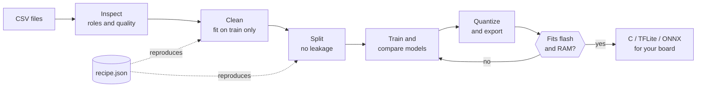
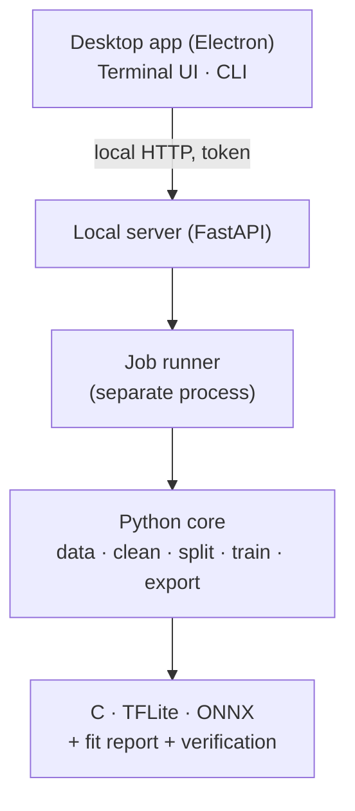

<div align="center">

<a href="../../README.md">English</a> · <b>Español</b> · <a href="README.ja.md">日本語</a> · <a href="README.fr.md">Français</a> · <a href="README.pt-BR.md">Português (Brasil)</a> · <a href="README.ko.md">한국어</a> · <a href="README.zh-CN.md">简体中文</a> · <a href="README.de.md">Deutsch</a> · <a href="README.it.md">Italiano</a> · <a href="README.ru.md">Русский</a>

# TinyML Studio

### Convierte datos de sensores en un modelo que cabe en tu microcontrolador.

<p>Limpia tus datos, entrena y compara modelos, cuantiza y exporta C, TFLite u ONNX, y comprueba que cabe en tu placa <b>antes</b> de grabar nada.</p>

<p><i>No se limita a un tipo de datos: Sirve cualquier tabla de números (sensores, máquinas, ambiente, wearables, encuestas). Los dos ejemplos en hardware de más abajo son solo pruebas: Uno es una encuesta de estudiantes y el otro usa lecturas eléctricas.</i></p>


<p><a href="#download">Descargar</a> · <a href="#quick-start">Inicio rápido</a> · <a href="#how">Cómo funciona</a> · <a href="#verified">Verificado en hardware</a> · <a href="#license">Licencia</a></p>

</div>

> Versión preliminar (v0.0.x). Verificada en PC (Windows 11 y Linux) y en una ESP32-S3 con dos ejemplos pequeños. Abajo está lo que sí y lo que no se ha verificado.

<a id="why"></a>
## Por qué existe
- Pasar de un CSV a un microcontrolador suele significar unir cuadernos, conversores y C escrito a mano, y descubrir al final que no cabe o que no se comporta como el modelo de Python.
- Aquí cada paso se guarda en una receta JSON reproducible, se ajusta solo con los datos de entrenamiento (sin fuga) y el modelo exportado se compara con el original.
- La app te dice con claridad qué se midió y qué es solo una estimación.

<a id="how"></a>
## Cómo funciona
Siete pasos guiados, desde tus archivos CSV hasta código que puedes pegar en el proyecto de tu placa.



1. <b>Dataset</b>: Abre uno o varios CSV; la app comprueba que se pueden mezclar.
2. <b>Tarea</b>: Elige qué predecir y el rol de cada columna.
3. <b>Limpieza</b>: Valores faltantes y absurdos, escalado. Cada paso se ajusta solo con train.
4. <b>Aumento</b> (opcional): Crea filas de entrenamiento nuevas a partir de tus filas reales. Bajo tu responsabilidad.
5. <b>Partición</b>: Train, validación y test sin fuga entre filas vecinas; equilibrado de clases opcional.
6. <b>Modelo y entrenamiento</b>: Compara modelos clásicos y redes pequeñas con las mismas particiones.
7. <b>Placa y exportación</b>: Cuantiza, comprueba flash y RAM y obtén código C, TFLite u ONNX.

### Arquitectura
Un núcleo en Python hace el aprendizaje automático, un pequeño servidor local lo expone y la app de escritorio (Electron) es solo la interfaz. La interfaz de terminal y la línea de comandos usan el mismo núcleo.



## Características
| | |
|---|---|
| **Datos** | Muchos CSV, exportaciones de InfluxDB, coma decimal y latin-1. Avisa cuando los archivos no deberían mezclarse. |
| **Evaluación honesta** | Validación dejando una sesión fuera, importancia por permutación, rechazo de clases desconocidas y detección de anomalías. El test se usa una sola vez. |
| **Modelos** | Modelos de scikit-learn, MLP y 1D-CNN de Keras con TensorFlow o PyTorch, banco de pruebas con validación cruzada y búsqueda dentro de tu presupuesto de flash y RAM. |
| **Exportación verificada** | C autónomo para modelos clásicos, TFLite (float, int8, float16) y ONNX, siempre comparados con el modelo original. |
| **Placas** | Fichas de ESP32-S3 y otras ESP32, Arduino, Raspberry Pi y STM32, cada dato con su fuente. |
| **Hardware** | Usa tu GPU NVIDIA o AMD si está disponible, muestra carga y temperatura al entrenar, tres interfaces (escritorio, terminal, CLI). |

## Qué puede entrenar y exportar
Aprendizaje supervisado (clasificación y regresión) y detección de anomalías sin supervisión. La app sugiere la tarea según tus columnas y tú la confirmas.

| | |
|---|---|
| **Tareas** | Clasificación y regresión, detección de anomalías sin etiquetas (Isolation Forest, One-Class SVM) entrenada solo con datos normales, y rechazo de clase desconocida para que el modelo pueda responder "no sé". No incluye agrupamiento (clustering). |
| **Modelos** | Clásicos: Árbol de decisión, random forest, extra trees, gradient boosting, regresión logística y lineal, Lasso, Elastic Net, LDA, SVM lineal, SVM y SVR, k-NN, Naive Bayes gaussiano, MLP. Redes: MLP de Keras y 1D-CNN sobre ventanas de filas consecutivas, con backend TensorFlow o PyTorch. |
| **Limpieza y aumento** | Imputación, valores absurdos, atípicos (IQR o z-score), escalado (estándar, min-max, robusto), duplicados y filtros. Aumento opcional de filas de entrenamiento con ruido gaussiano o interpolación tipo SMOTE. Todo se ajusta solo con train. |
| **Partición y evaluación** | Aleatoria, estratificada, por grupo o por bloques temporales, con balanceo de clases opcional. Benchmark con validación cruzada, búsqueda de hiperparámetros bajo tu presupuesto de flash y RAM, importancia por permutación. El test se usa una sola vez. |
| **Exportación** | C99 sin dependencias (modelos lineales, árboles y bosques, SVM, MLP, Naive Bayes, y un formato compacto para bosques), TFLite (float, int8, float16), ONNX y sketches de Arduino. No todos los modelos exportan a todo: La app te dice cuáles sí. |
| **Verificación** | Informe de flash y RAM por placa, comparación Keras contra TFLite contra int8, y vectores de prueba que comparan el C con Python. La latencia es una estimación, no una medición. |

<a id="verified"></a>
## Verificado en hardware
Se han ejecutado de principio a fin dos ejemplos pequeños y reales en una ESP32-S3. Demuestran que la cadena funciona; no son pruebas comparativas.

| Ejemplo | En el ordenador | En la ESP32-S3 |
|---|---|---|
| Regresión: Nota de examen a partir de una encuesta (dataset público, 6 607 filas) | R² 0,943 en el test; el C generado coincide con scikit-learn en el 100 % de 656 vectores | 6 de 6 casos de la encuesta coinciden con Python (por ejemplo 72,1 frente a 72,12); 22 % del flash de programa |
| Clasificación: Distinguir dos ventiladores domésticos con cuatro lecturas eléctricas | F1 macro 1,000 en el test (dos grabaciones: No prueba generalización); el C coincide con Python en el 100 % de los vectores | 6 de 6 lecturas estables en vivo correctas; un transitorio al cambiar de ventilador se clasificó mal |

<b>No verificado:</b> Otras placas, latencia y consumo medidos (las cifras de latencia son estimaciones), entrenamiento en GPU AMD, macOS, otros aparatos u otros días en el ejemplo de clasificación, y los sketches de Arduino en todas las versiones del IDE.

<a id="download"></a>
## Descargar y ejecutar
Los instaladores se publican en la página de <b>Releases</b>. No hace falta Python ni Node.js para probar la app. Los instaladores de Windows no están firmados, así que SmartScreen puede avisar ("Más información" y luego "Ejecutar de todas formas").

| Plataforma | Archivo |
|---|---|
| Windows 10 / 11 | Instalador <code>.exe</code> o <code>.zip</code> |
| Linux | <code>.AppImage</code> o <code>.deb</code> |

<a id="quick-start"></a>
### Compilar desde el código
```bash
pip install -e ".[dev]"             # core + tests
python -m tinyml_studio.cli --help  # command line
cd ui && npm install && npm start   # desktop app (Python 3.10+, Node.js 20+)
```

## Documentación
Manual de usuario (PDF, en inglés, con capturas): <a href="../manual/TinyML-Studio-User-Manual.pdf">docs/manual</a>.

## Contribuir
Se agradecen incidencias y pull requests, sobre todo validaciones en placas reales (indica placa, herramientas y resultados), fichas de placas nuevas con sus fuentes, traducciones y nuevos exportadores. Ejecuta <code>ruff check .</code> y <code>pytest</code> antes de abrir un pull request.

<a id="license"></a>
## Licencia
Software libre bajo la <b>GNU General Public License v3.0</b> (ver <a href="../../LICENSE">LICENSE</a>). Puedes usarlo, estudiarlo, modificarlo y redistribuirlo; las obras derivadas que se distribuyan deben seguir abiertas con la misma licencia. Las dependencias conservan sus propias licencias.

## Tus modelos y el código generado
Los modelos que entrenas y el código y los archivos que TinyML Studio genera para tus proyectos (C, TFLite, ONNX, sketches de Arduino) son tuyos. Puedes usarlos con cualquier licencia, incluso en productos cerrados. La GPL-3.0 cubre la aplicación, no lo que haces con ella.

## Créditos
Copyright © 2026 BrianGTRxx. Diseñado y dirigido por el autor y <b>desarrollado con la ayuda de Claude</b> (Anthropic). Ver <a href="../../AUTHORS.md">AUTHORS.md</a>.
