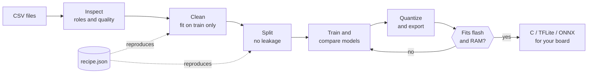
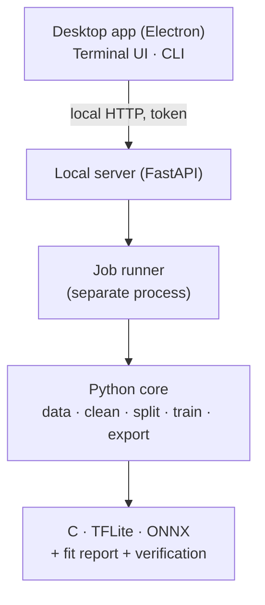

<div align="center">

<a href="../../README.md">English</a> · <a href="README.es.md">Español</a> · <a href="README.ja.md">日本語</a> · <b>Français</b> · <a href="README.pt-BR.md">Português (Brasil)</a> · <a href="README.ko.md">한국어</a> · <a href="README.zh-CN.md">简体中文</a> · <a href="README.de.md">Deutsch</a> · <a href="README.it.md">Italiano</a> · <a href="README.ru.md">Русский</a>

# TinyML Studio

### Transformez vos données de capteurs en un modèle qui tient dans votre microcontrôleur.

<p>Nettoyez vos données, entraînez et comparez des modèles, quantifiez et exportez en C, TFLite ou ONNX, et vérifiez que le résultat tient sur votre carte <b>avant</b> de la programmer.</p>

<p><i>Elle n'est pas limitée à un type de données : N'importe quel tableau de nombres convient (capteurs, machines, environnement, objets portés, enquêtes). Les deux exemples sur matériel ci-dessous ne sont que des tests : L'un est un questionnaire d'élèves, l'autre utilise des mesures électriques.</i></p>


<p><a href="#download">Télécharger</a> · <a href="#quick-start">Démarrage rapide</a> · <a href="#how">Fonctionnement</a> · <a href="#verified">Vérifié sur matériel</a> · <a href="#license">Licence</a></p>

</div>

> Préversion (v0.0.x). Vérifiée sur PC (Windows 11 et Linux) et sur une ESP32-S3 avec deux petits exemples. Ce qui est vérifié et ce qui ne l'est pas figure plus bas.

> 🌐 Cette traduction a été réalisée avec l'aide d'une IA. Les corrections par pull request sont les bienvenues.

<a id="why"></a>
## Pourquoi ce projet
- Passer d'un CSV à un microcontrôleur oblige souvent à assembler des notebooks, des convertisseurs et du C écrit à la main, pour découvrir à la fin que cela ne tient pas ou ne se comporte pas comme le modèle Python.
- Ici, chaque étape est enregistrée dans une recette JSON reproductible, ajustée uniquement sur les données d'entraînement (sans fuite), et le modèle exporté est comparé à l'original.
- L'application indique clairement ce qui a été mesuré et ce qui n'est qu'une estimation.

<a id="how"></a>
## Fonctionnement
Sept étapes guidées, de vos fichiers CSV jusqu'au code à coller dans le projet de votre carte.



1. <b>Jeu de données</b> : Ouvrez un ou plusieurs CSV ; l'application vérifie qu'ils peuvent être fusionnés.
2. <b>Tâche</b> : Choisissez la cible et le rôle de chaque colonne.
3. <b>Nettoyage</b> : Valeurs manquantes et aberrantes, mise à l'échelle. Chaque étape est ajustée sur l'entraînement seul.
4. <b>Augmentation</b> (facultatif) : Crée de nouvelles lignes d'entraînement à partir de vos lignes réelles. Sous votre responsabilité.
5. <b>Partition</b> : Entraînement, validation et test sans fuite entre lignes voisines ; équilibrage des classes en option.
6. <b>Modèle et entraînement</b> : Comparez modèles classiques et petits réseaux sur des partitions identiques.
7. <b>Carte et export</b> : Quantification, vérification de la flash et de la RAM, puis code C, TFLite ou ONNX.

### Architecture
Un noyau Python réalise l'apprentissage, un petit serveur local l'expose, et l'application de bureau (Electron) n'est que l'interface. L'interface en terminal et la ligne de commande utilisent le même noyau.



## Fonctionnalités
| | |
|---|---|
| **Données** | Plusieurs CSV, exports InfluxDB, virgule décimale et latin-1. Avertit quand des fichiers ne devraient pas être fusionnés. |
| **Évaluation honnête** | Validation en laissant une session de côté, importance par permutation, rejet des classes inconnues et détection d'anomalies. Le jeu de test n'est utilisé qu'une fois. |
| **Modèles** | Modèles scikit-learn, MLP et CNN 1D Keras avec TensorFlow ou PyTorch, banc d'essai avec validation croisée et recherche dans votre budget de flash et de RAM. |
| **Export vérifié** | C autonome pour les modèles classiques, TFLite (float, int8, float16) et ONNX, toujours comparés au modèle d'origine. |
| **Cartes** | Fiches pour ESP32-S3 et autres ESP32, Arduino, Raspberry Pi et STM32, chaque donnée avec sa source. |
| **Matériel** | Utilise votre GPU NVIDIA ou AMD s'il est disponible, affiche charge et température pendant l'entraînement, trois interfaces (bureau, terminal, CLI). |

<a id="verified"></a>
## Vérifié sur matériel
Deux petits exemples réels ont été exécutés de bout en bout sur une ESP32-S3. Ils montrent que la chaîne fonctionne ; ce ne sont pas des benchmarks.

| Exemple | Sur l'ordinateur | Sur l'ESP32-S3 |
|---|---|---|
| Régression : Note d'examen à partir d'un questionnaire (jeu public, 6 607 lignes) | R² 0,943 sur le jeu de test ; le C généré est identique à scikit-learn sur 100 % de 656 vecteurs | 6 cas sur 6 identiques à Python (par exemple 72,1 contre 72,12) ; 22 % de la flash programme |
| Classification : Distinguer deux ventilateurs domestiques à partir de quatre mesures électriques | F1 macro 1,000 sur le test (deux enregistrements : Ce n'est pas une preuve de généralisation) ; le C égale Python sur 100 % des vecteurs | 6 mesures stables en direct sur 6 correctes ; un régime transitoire lors du changement de ventilateur a été mal classé |

<b>Non vérifié :</b> Autres cartes, latence et consommation mesurées (les chiffres de latence sont des estimations), entraînement sur GPU AMD, macOS, autres appareils ou autres jours pour l'exemple de classification, et les croquis Arduino générés dans toutes les versions de l'IDE.

<a id="download"></a>
## Télécharger et exécuter
Les installateurs sont publiés sur la page <b>Releases</b>. Ni Python ni Node.js ne sont nécessaires pour essayer l'application. Les installateurs Windows ne sont pas signés : SmartScreen peut afficher un avertissement (« Informations complémentaires », puis « Exécuter quand même »).

| Plateforme | Fichier |
|---|---|
| Windows 10 / 11 | Installateur <code>.exe</code> ou <code>.zip</code> |
| Linux | <code>.AppImage</code> ou <code>.deb</code> |

<a id="quick-start"></a>
### Compiler depuis les sources
```bash
pip install -e ".[dev]"             # core + tests
python -m tinyml_studio.cli --help  # command line
cd ui && npm install && npm start   # desktop app (Python 3.10+, Node.js 20+)
```

## Documentation
Manuel d'utilisation (PDF, en anglais, avec captures) : <a href="../manual/TinyML-Studio-User-Manual.pdf">docs/manual</a>.

## Contribuer
Les issues et les pull requests sont les bienvenues, surtout les validations sur cartes réelles (indiquez carte, chaîne d'outils et résultats), les nouvelles fiches de cartes avec sources, les traductions et les nouveaux exporteurs. Lancez <code>ruff check .</code> et <code>pytest</code> avant d'ouvrir une pull request.

<a id="license"></a>
## Licence
Logiciel libre sous <b>GNU General Public License v3.0</b> (voir <a href="../../LICENSE">LICENSE</a>). Vous pouvez l'utiliser, l'étudier, le modifier et le redistribuer ; les œuvres dérivées distribuées doivent rester ouvertes sous la même licence. Les dépendances conservent leurs propres licences.

## Vos modèles et le code généré
Les modèles que vous entraînez ainsi que le code et les fichiers que TinyML Studio génère pour vos projets (C, TFLite, ONNX, croquis Arduino) vous appartiennent. Vous pouvez les utiliser sous n'importe quelle licence, y compris dans des produits fermés. La GPL-3.0 couvre l'application elle-même, pas ce que vous en faites.

## Crédits
Copyright © 2026 BrianGTRxx. Conçu et dirigé par l'auteur et <b>développé avec l'aide de Claude</b> (Anthropic). Voir <a href="../../AUTHORS.md">AUTHORS.md</a>.
