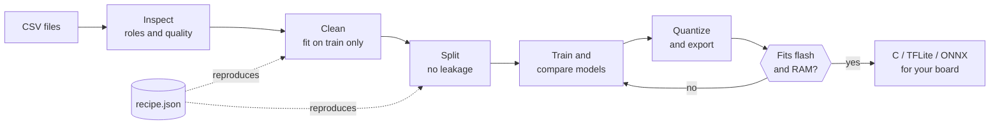
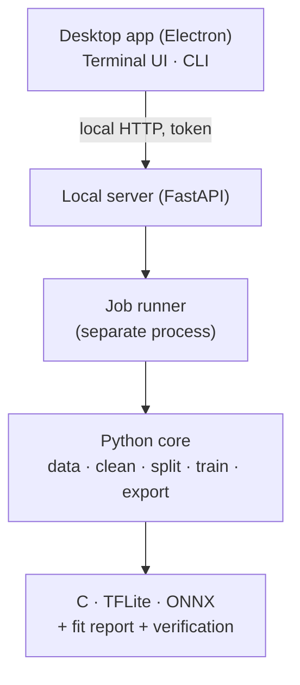

<div align="center">

<a href="../../README.md">English</a> · <a href="README.es.md">Español</a> · <a href="README.ja.md">日本語</a> · <a href="README.fr.md">Français</a> · <a href="README.pt-BR.md">Português (Brasil)</a> · <a href="README.ko.md">한국어</a> · <a href="README.zh-CN.md">简体中文</a> · <a href="README.de.md">Deutsch</a> · <b>Italiano</b> · <a href="README.ru.md">Русский</a>

# TinyML Studio

### Trasforma i dati dei sensori in un modello che entra nel tuo microcontrollore.

<p>Pulisci i dati, addestra e confronta modelli, quantizza ed esporta C, TFLite o ONNX e verifica che entri nella tua scheda <b>prima</b> di programmarla.</p>

<p><i>Non è limitata a un tipo di dati: Va bene qualsiasi tabella di numeri (sensori, macchine, ambiente, wearable, questionari). I due esempi su hardware qui sotto sono solo test: Uno è un questionario di studenti, l'altro usa letture elettriche.</i></p>


<p><a href="#download">Scarica</a> · <a href="#quick-start">Avvio rapido</a> · <a href="#how">Come funziona</a> · <a href="#verified">Verificato su hardware</a> · <a href="#license">Licenza</a></p>

</div>

> Pre-release (v0.0.x). Verificata su PC (Windows 11 e Linux) e su una ESP32-S3 con due piccoli esempi. Più sotto trovi cosa è stato verificato e cosa no.

> 🌐 Questa traduzione è stata realizzata con l'aiuto dell'IA. Le correzioni tramite pull request sono benvenute.

<a id="why"></a>
## Perché esiste
- Passare da un CSV a un microcontrollore di solito significa unire notebook, convertitori e C scritto a mano, e scoprire alla fine che non entra o che non si comporta come il modello Python.
- Qui ogni passaggio viene salvato in una ricetta JSON riproducibile, adattata solo ai dati di addestramento (senza fughe di dati), e il modello esportato viene confrontato con l'originale.
- L'app ti dice con chiarezza cosa è stato misurato e cosa è solo una stima.

<a id="how"></a>
## Come funziona
Sette passaggi guidati, dai tuoi file CSV al codice da incollare nel progetto della tua scheda.



1. <b>Dataset</b>: Apri uno o più CSV; l'app verifica che si possano unire.
2. <b>Compito</b>: Scegli cosa prevedere e il ruolo di ogni colonna.
3. <b>Pulizia</b>: Valori mancanti e assurdi, scalatura. Ogni passaggio è adattato solo sull'addestramento.
4. <b>Aumento</b> (facoltativo): Crea nuove righe di addestramento a partire dalle tue righe reali. Sotto la tua responsabilità.
5. <b>Suddivisione</b>: Addestramento, validazione e test senza fughe tra righe vicine; bilanciamento delle classi facoltativo.
6. <b>Modello e addestramento</b>: Confronta modelli classici e piccole reti sulle stesse suddivisioni.
7. <b>Scheda ed esportazione</b>: Quantizza, verifica flash e RAM e ottieni codice C, TFLite o ONNX.

### Architettura
Un nucleo Python esegue l'apprendimento automatico, un piccolo server locale lo espone e l'app desktop (Electron) è solo l'interfaccia. L'interfaccia a terminale e la riga di comando usano lo stesso nucleo.



## Funzionalità
| | |
|---|---|
| **Dati** | Molti CSV, esportazioni InfluxDB, virgola decimale e latin-1. Avvisa quando i file non andrebbero uniti. |
| **Valutazione onesta** | Validazione lasciando fuori una sessione, importanza per permutazione, rifiuto delle classi sconosciute e rilevamento di anomalie. Il test si usa una sola volta. |
| **Modelli** | Modelli scikit-learn, MLP e CNN 1D di Keras con TensorFlow o PyTorch, benchmark con validazione incrociata e ricerca entro il tuo budget di flash e RAM. |
| **Esportazione verificata** | C autonomo per i modelli classici, TFLite (float, int8, float16) e ONNX, sempre confrontati con il modello originale. |
| **Schede** | Schede tecniche per ESP32-S3 e altre ESP32, Arduino, Raspberry Pi e STM32, ogni dato con la sua fonte. |
| **Hardware** | Usa la tua GPU NVIDIA o AMD se disponibile, mostra carico e temperatura durante l'addestramento, tre interfacce (desktop, terminale, CLI). |

<a id="verified"></a>
## Verificato su hardware
Due piccoli esempi reali sono stati eseguiti dall'inizio alla fine su una ESP32-S3. Mostrano che la catena funziona; non sono benchmark.

| Esempio | Sul computer | Sulla ESP32-S3 |
|---|---|---|
| Regressione: Voto d'esame da un questionario (dataset pubblico, 6.607 righe) | R² 0,943 sul test; il C generato coincide con scikit-learn nel 100 % di 656 vettori | 6 casi su 6 del questionario coincidono con Python (ad esempio 72,1 contro 72,12); 22 % della flash di programma |
| Classificazione: Distinguere due ventilatori domestici da quattro letture elettriche | F1 macro 1,000 sul test (due registrazioni: Non prova la generalizzazione); il C coincide con Python nel 100 % dei vettori | 6 letture stabili dal vivo su 6 corrette; un transitorio durante il cambio di ventilatore è stato classificato male |

<b>Non verificato:</b> Altre schede, latenza e consumo misurati (le cifre di latenza sono stime), addestramento su GPU AMD, macOS, altri apparecchi o altri giorni nell'esempio di classificazione e gli sketch Arduino generati in tutte le versioni dell'IDE.

<a id="download"></a>
## Scarica ed esegui
Gli installatori sono pubblicati nella pagina <b>Releases</b>. Per provare l'app non servono né Python né Node.js. Gli installatori di Windows non sono firmati, quindi SmartScreen può avvisare ("Ulteriori informazioni", poi "Esegui comunque").

| Piattaforma | File |
|---|---|
| Windows 10 / 11 | Installatore <code>.exe</code> o <code>.zip</code> |
| Linux | <code>.AppImage</code> o <code>.deb</code> |

<a id="quick-start"></a>
### Compilare dai sorgenti
```bash
pip install -e ".[dev]"             # core + tests
python -m tinyml_studio.cli --help  # command line
cd ui && npm install && npm start   # desktop app (Python 3.10+, Node.js 20+)
```

## Documentazione
Manuale utente (PDF, in inglese, con schermate): <a href="../manual/TinyML-Studio-User-Manual.pdf">docs/manual</a>.

## Contribuire
Issue e pull request sono benvenute, soprattutto validazioni su schede reali (indica scheda, toolchain e risultati), nuove schede tecniche con fonti, traduzioni e nuovi esportatori. Esegui <code>ruff check .</code> e <code>pytest</code> prima di aprire una pull request.

<a id="license"></a>
## Licenza
Software libero con licenza <b>GNU General Public License v3.0</b> (vedi <a href="../../LICENSE">LICENSE</a>). Puoi usarlo, studiarlo, modificarlo e ridistribuirlo; le opere derivate distribuite devono restare aperte con la stessa licenza. Le dipendenze mantengono le proprie licenze.

## I tuoi modelli e il codice generato
I modelli che addestri e il codice e i file che TinyML Studio genera per i tuoi progetti (C, TFLite, ONNX, sketch Arduino) sono tuoi. Puoi usarli con qualsiasi licenza, anche in prodotti chiusi. La GPL-3.0 copre l'applicazione, non ciò che ci realizzi.

## Crediti
Copyright © 2026 BrianGTRxx. Progettato e diretto dall'autore e <b>sviluppato con l'aiuto di Claude</b> (Anthropic). Vedi <a href="../../AUTHORS.md">AUTHORS.md</a>.
