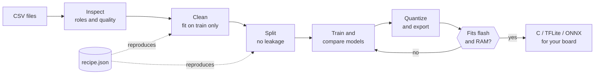
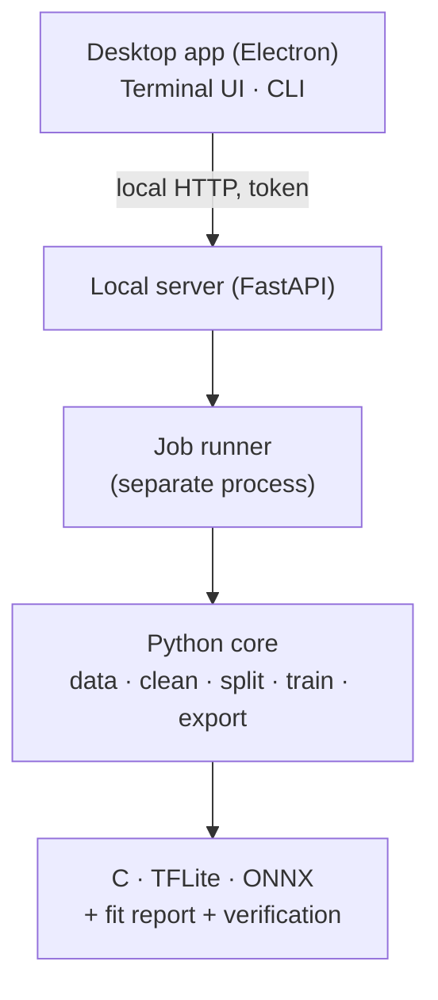

<div align="center">

<a href="../../README.md">English</a> · <a href="README.es.md">Español</a> · <b>日本語</b> · <a href="README.fr.md">Français</a> · <a href="README.pt-BR.md">Português (Brasil)</a> · <a href="README.ko.md">한국어</a> · <a href="README.zh-CN.md">简体中文</a> · <a href="README.de.md">Deutsch</a> · <a href="README.it.md">Italiano</a> · <a href="README.ru.md">Русский</a>

# TinyML Studio

### センサーデータを、マイコンに収まるモデルに変えます。

<p>データのクリーニング、モデルの学習と比較、量子化、C・TFLite・ONNX への書き出しを行い、ボードに書き込む<b>前に</b>収まるかどうかを確認できます。</p>

<p><i>特定の種類のデータに限定されません。数値の表であれば何でも使えます (センサー、機械、環境、ウェアラブル、アンケートなど)。下の 2 つのハードウェア例は単なるテストで、1 つは生徒アンケート、もう 1 つは電気の測定値を使っています。</i></p>


<p><a href="#download">ダウンロード</a> · <a href="#quick-start">クイックスタート</a> · <a href="#how">仕組み</a> · <a href="#verified">実機での検証</a> · <a href="#license">ライセンス</a></p>

</div>

> プレリリース (v0.0.x)。PC (Windows 11 と Linux) と、2 つの小さな例による ESP32-S3 で検証済みです。検証済みの範囲と未検証の範囲は下記をご覧ください。

> 🌐 この翻訳は AI の支援で作成しました。誤りがあれば pull request で修正をお寄せください。

<a id="why"></a>
## なぜ作ったか
- CSV からマイコンまで進むには、ノートブック、変換ツール、手書きの C をつなぎ合わせ、最後に「収まらない」「Python のモデルと挙動が違う」と気づくことがよくあります。
- ここでは各ステップが再現可能な JSON レシピとして保存され、学習データだけで適合され (リークなし)、書き出したモデルは元のモデルと比較されます。
- 何を実測し、何が推定にすぎないかを、はっきりとお伝えします。

<a id="how"></a>
## 仕組み
CSV ファイルから、ボードのプロジェクトに貼り付けられるコードまで、7 つのガイド付きステップで進みます。



1. <b>データセット</b>: 1 つまたは複数の CSV を開きます。混ぜてよいかをアプリが確認します。
2. <b>タスク</b>: 予測する対象と各列の役割を選びます。
3. <b>クリーニング</b>: 欠損値と異常値、スケーリング。各ステップは学習データだけで適合されます。
4. <b>拡張</b> (任意): 実際の行から新しい学習用の行を作ります。自己責任で行ってください。
5. <b>分割</b>: 隣接する行のリークなしで train・validation・test に分けます。クラスのバランス調整も選べます。
6. <b>モデルと学習</b>: 同一の分割で、古典的モデルと小さなネットワークを比較します。
7. <b>ボードと書き出し</b>: 量子化し、フラッシュと RAM を確認して、C コード、TFLite、ONNX を取得します。

### アーキテクチャ
機械学習は Python のコアが行い、小さなローカルサーバーがそれを公開し、デスクトップアプリ (Electron) は画面を担当するだけです。ターミナル UI とコマンドラインも同じコアを使います。



## 機能
| | |
|---|---|
| **データ** | 複数の CSV、InfluxDB のエクスポート、小数点のカンマ、latin-1 に対応。混ぜるべきでないファイルは警告します。 |
| **誠実な評価** | セッション単位の leave-one-out 検証、順列重要度、未知クラスの拒否、異常検知。テストデータは 1 回だけ使います。 |
| **モデル** | scikit-learn のモデル、TensorFlow または PyTorch の Keras MLP と 1D-CNN、交差検証つきのベンチマーク、フラッシュと RAM の予算内での探索。 |
| **検証付き書き出し** | 古典的モデルは単体の C、ほかに TFLite (float・int8・float16) と ONNX。常に元のモデルと照合します。 |
| **ボード** | ESP32-S3 などの ESP32、Arduino、Raspberry Pi、STM32 のボードシート。各項目に出典があります。 |
| **ハードウェア** | 利用可能なら NVIDIA / AMD の GPU を使用し、学習中の負荷と温度を表示。デスクトップ、ターミナル、CLI の 3 つのインターフェース。 |

## 学習とエクスポートができるもの
教師あり学習（分類と回帰）と、教師なしの異常検知に対応します。タスクは列の内容から提案され、あなたが確認します。

| | |
|---|---|
| **タスク** | 分類と回帰、正常データだけで学習するラベルなしの異常検知（Isolation Forest、One-Class SVM）、そしてモデルが「わからない」と答えられる未知クラスの棄却。クラスタリングは含まれません。 |
| **モデル** | 従来型: 決定木、ランダムフォレスト、Extra Trees、勾配ブースティング、ロジスティック回帰と線形回帰、Lasso、Elastic Net、LDA、線形SVM、SVMとSVR、k-NN、ガウスNaive Bayes、MLP。ニューラル: Keras の MLP と、連続した行のウィンドウに対する 1D-CNN（TensorFlow または PyTorch バックエンド）。 |
| **クリーニングとデータ拡張** | 欠損値の補完、異常値、外れ値（IQR または z-score）、スケーリング（標準、min-max、ロバスト）、重複、フィルタ。学習行にガウスノイズまたは SMOTE 風の補間を加える任意のデータ拡張。すべて学習データだけで適合します。 |
| **分割と評価** | ランダム、層化、グループ別、時間ブロック。クラスのバランス調整は任意。交差検証によるベンチマーク、フラッシュとRAMの予算内でのハイパーパラメータ探索、順列重要度。テストセットは1回だけ使います。 |
| **エクスポート** | 依存のない C99（線形モデル、木とフォレスト、SVM、MLP、Naive Bayes、フォレスト用の小型レイアウト）、TFLite（float、int8、float16）、ONNX、Arduino スケッチ。すべてのモデルがすべての形式に出力できるわけではなく、可否はアプリが表示します。 |
| **検証** | ボードごとのフラッシュとRAMのレポート、Keras と TFLite と int8 の比較、C コードを Python と照合するテストベクトル。レイテンシは測定値ではなく推定値です。 |

<a id="verified"></a>
## 実機での検証
小さな実例を 2 つ、ESP32-S3 で最初から最後まで実行しました。パイプラインが動くことを示すもので、ベンチマークではありません。

| 例 | コンピューター上 | ESP32-S3 上 |
|---|---|---|
| 回帰: 生徒アンケートから試験の点数を予測 (公開データセット、6,607 行) | ホールドアウトのテストで R² 0.943。生成した C は 656 件のテストベクトルすべてで scikit-learn と一致 | アンケート 6 件すべてが Python と一致 (例: 72.1 と 72.12)。プログラムフラッシュの 22 % |
| 分類: 4 つの電気量の読み取り値から 2 台の家庭用扇風機を判別 | テストで F1 macro 1.000 (録音は 2 本のため、汎化の証明ではありません)。C はすべてのベクトルで Python と一致 | 安定したライブ測定 6 件すべて正解。扇風機の切り替え時の過渡状態は誤分類 |

<b>未検証:</b> ほかのボード、実測のレイテンシと消費電力 (レイテンシの数値は推定です)、AMD GPU での学習、macOS、分類例でのほかの家電や別の日、すべての Arduino IDE バージョンでの生成スケッチ。

<a id="download"></a>
## ダウンロードと実行
インストーラーは <b>Releases</b> ページで公開されます。試すだけなら Python も Node.js も不要です。Windows のインストーラーは署名されていないため、SmartScreen が警告する場合があります (「詳細情報」→「実行」)。

| プラットフォーム | ファイル |
|---|---|
| Windows 10 / 11 | セットアップ <code>.exe</code> または <code>.zip</code> |
| Linux | <code>.AppImage</code> または <code>.deb</code> |

<a id="quick-start"></a>
### ソースからビルド
```bash
pip install -e ".[dev]"             # core + tests
python -m tinyml_studio.cli --help  # command line
cd ui && npm install && npm start   # desktop app (Python 3.10+, Node.js 20+)
```

## ドキュメント
ユーザーマニュアル (PDF、英語、スクリーンショット付き): <a href="../manual/TinyML-Studio-User-Manual.pdf">docs/manual</a>。

## 貢献
Issue とプルリクエストを歓迎します。特に実機での検証 (ボード、ツールチェーン、結果をご報告ください)、出典つきの新しいボードシート、翻訳、新しいエクスポーターを歓迎します。プルリクエストの前に <code>ruff check .</code> と <code>pytest</code> を実行してください。

<a id="license"></a>
## ライセンス
<b>GNU General Public License v3.0</b> のフリーソフトウェアです (<a href="../../LICENSE">LICENSE</a> を参照)。使用、研究、改変、再配布が可能で、配布する派生物は同じライセンスで公開し続ける必要があります。依存ライブラリはそれぞれのライセンスに従います。

## モデルと生成コードはあなたのもの
あなたが学習したモデルと、TinyML Studio があなたのプロジェクト用に生成するコードやファイル (C、TFLite、ONNX、Arduino スケッチ) はあなたのものです。クローズドな製品を含め、どんなライセンスでも使えます。GPL-3.0 が対象とするのはアプリケーション自体であり、それで作ったものではありません。

## クレジット
Copyright © 2026 BrianGTRxx。作者が設計・指揮し、<b>Claude (Anthropic) の支援を受けて開発</b>しました。<a href="../../AUTHORS.md">AUTHORS.md</a> を参照してください。
