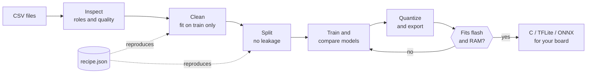
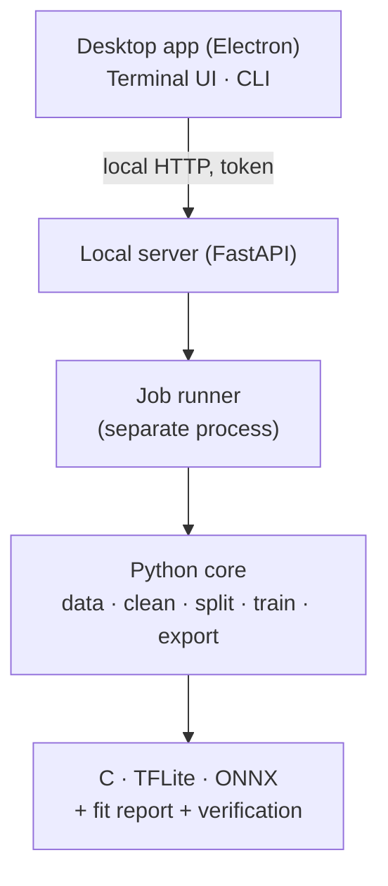

<div align="center">

<a href="../../README.md">English</a> · <a href="README.es.md">Español</a> · <a href="README.ja.md">日本語</a> · <a href="README.fr.md">Français</a> · <a href="README.pt-BR.md">Português (Brasil)</a> · <b>한국어</b> · <a href="README.zh-CN.md">简体中文</a> · <a href="README.de.md">Deutsch</a> · <a href="README.it.md">Italiano</a> · <a href="README.ru.md">Русский</a>

# TinyML Studio

### 센서 데이터를 마이크로컨트롤러에 들어가는 모델로 바꿔 줍니다.

<p>데이터를 정리하고, 모델을 학습·비교하고, 양자화하여 C, TFLite, ONNX로 내보내며, 보드에 올리기 <b>전에</b> 들어가는지 확인합니다.</p>

<p><i>특정 종류의 데이터에 한정되지 않습니다. 숫자로 된 표라면 무엇이든 사용할 수 있습니다(센서, 기계, 환경, 웨어러블, 설문 등). 아래의 두 하드웨어 예제는 테스트일 뿐이며, 하나는 학생 설문이고 다른 하나는 전기 측정값을 사용합니다.</i></p>


<p><a href="#download">다운로드</a> · <a href="#quick-start">빠른 시작</a> · <a href="#how">작동 방식</a> · <a href="#verified">실제 하드웨어 검증</a> · <a href="#license">라이선스</a></p>

</div>

> 프리릴리스 (v0.0.x). PC (Windows 11, Linux)와 두 개의 작은 예제로 ESP32-S3에서 검증했습니다. 검증된 범위와 그렇지 않은 범위는 아래에 있습니다.

> 🌐 이 번역은 AI의 도움으로 작성되었습니다. 오류는 풀 리퀘스트로 고쳐 주세요.

<a id="why"></a>
## 만든 이유
- CSV에서 마이크로컨트롤러까지 가려면 노트북, 변환기, 직접 쓴 C 코드를 이어 붙여야 하고, 마지막에야 용량이 맞지 않거나 파이썬 모델과 동작이 다르다는 사실을 알게 되는 경우가 많습니다.
- 여기서는 모든 단계가 재현 가능한 JSON 레시피로 저장되고, 학습 데이터로만 맞춰지며(누수 없음), 내보낸 모델은 원본과 비교됩니다.
- 무엇을 측정했고 무엇이 추정치일 뿐인지 분명하게 알려 줍니다.

<a id="how"></a>
## 작동 방식
CSV 파일에서 보드 프로젝트에 붙여 넣을 코드까지, 안내되는 7단계로 진행합니다.



1. <b>데이터셋</b>: CSV 파일을 하나 이상 엽니다. 섞어도 되는지 앱이 확인합니다.
2. <b>작업</b>: 예측할 대상과 각 열의 역할을 고릅니다.
3. <b>정리</b>: 결측값과 비정상 값, 스케일링. 각 단계는 학습 데이터로만 맞춥니다.
4. <b>증강</b> (선택): 실제 행에서 새로운 학습용 행을 만듭니다. 사용자의 책임하에 사용하세요.
5. <b>분할</b>: 인접한 행의 누수 없이 train, validation, test로 나눕니다. 클래스 균형 맞추기는 선택입니다.
6. <b>모델과 학습</b>: 동일한 분할에서 고전 모델과 작은 신경망을 비교합니다.
7. <b>보드와 내보내기</b>: 양자화하고 플래시와 RAM을 확인한 뒤 C 코드, TFLite, ONNX를 받습니다.

### 아키텍처
파이썬 코어가 머신러닝을 수행하고, 작은 로컬 서버가 이를 제공하며, 데스크톱 앱(Electron)은 화면만 담당합니다. 터미널 UI와 명령줄도 같은 코어를 사용합니다.



## 기능
| | |
|---|---|
| **데이터** | 여러 CSV, InfluxDB 내보내기, 소수점 쉼표, latin-1 지원. 섞으면 안 되는 파일은 경고합니다. |
| **정직한 평가** | 세션 단위 leave-one-out 검증, 순열 중요도, 미지 클래스 거부, 이상 탐지. 테스트 데이터는 한 번만 사용합니다. |
| **모델** | scikit-learn 모델, TensorFlow 또는 PyTorch 기반 Keras MLP와 1D-CNN, 교차 검증 벤치마크, 플래시와 RAM 예산 안에서의 탐색. |
| **검증된 내보내기** | 고전 모델은 독립 실행형 C, 그 밖에 TFLite(float, int8, float16)와 ONNX. 항상 원본 모델과 대조합니다. |
| **보드** | ESP32-S3 및 기타 ESP32, Arduino, Raspberry Pi, STM32 보드 시트. 각 항목에 출처가 있습니다. |
| **하드웨어** | 사용 가능하면 NVIDIA 또는 AMD GPU를 사용하고, 학습 중 부하와 온도를 표시합니다. 데스크톱, 터미널, CLI의 세 가지 인터페이스. |

<a id="verified"></a>
## 실제 하드웨어 검증
작은 실제 예제 두 개를 ESP32-S3에서 처음부터 끝까지 실행했습니다. 파이프라인이 동작함을 보여 줄 뿐 벤치마크는 아닙니다.

| 예제 | 컴퓨터에서 | ESP32-S3에서 |
|---|---|---|
| 회귀: 학생 설문으로 시험 점수 예측 (공개 데이터셋, 6,607행) | 홀드아웃 테스트에서 R² 0.943. 생성된 C 코드는 656개 테스트 벡터 전부에서 scikit-learn과 일치 | 설문 6건 모두 Python과 일치 (예: 72.1과 72.12). 프로그램 플래시의 22 % |
| 분류: 전기 측정값 4개로 가정용 선풍기 두 대 구분 | 테스트에서 F1 macro 1.000 (녹음이 두 개뿐이라 일반화의 증거는 아님). C는 모든 벡터에서 Python과 일치 | 안정적인 실시간 측정 6건 모두 정답. 선풍기를 바꾸는 순간의 과도 상태는 오분류 |

<b>검증되지 않음:</b> 다른 보드, 실측 지연 시간과 전력(지연 시간 수치는 추정치), AMD GPU 학습, macOS, 분류 예제의 다른 가전이나 다른 날, 모든 Arduino IDE 버전에서의 생성된 스케치.

<a id="download"></a>
## 다운로드 및 실행
설치 파일은 <b>Releases</b> 페이지에 게시됩니다. 앱을 써 보는 데 Python이나 Node.js는 필요 없습니다. Windows 설치 파일은 서명되지 않아 SmartScreen이 경고할 수 있습니다("추가 정보" 후 "실행").

| 플랫폼 | 파일 |
|---|---|
| Windows 10 / 11 | 설치 <code>.exe</code> 또는 <code>.zip</code> |
| Linux | <code>.AppImage</code> 또는 <code>.deb</code> |

<a id="quick-start"></a>
### 소스에서 빌드
```bash
pip install -e ".[dev]"             # core + tests
python -m tinyml_studio.cli --help  # command line
cd ui && npm install && npm start   # desktop app (Python 3.10+, Node.js 20+)
```

## 문서
사용자 매뉴얼 (PDF, 영어, 스크린샷 포함): <a href="../manual/TinyML-Studio-User-Manual.pdf">docs/manual</a>.

## 기여하기
이슈와 풀 리퀘스트를 환영합니다. 특히 실제 보드에서의 검증(보드, 툴체인, 결과를 알려 주세요), 출처가 있는 새 보드 시트, 번역, 새 내보내기 기능을 환영합니다. 풀 리퀘스트 전에 <code>ruff check .</code>와 <code>pytest</code>를 실행해 주세요.

<a id="license"></a>
## 라이선스
<b>GNU General Public License v3.0</b>의 자유 소프트웨어입니다 (<a href="../../LICENSE">LICENSE</a> 참조). 사용, 연구, 수정, 재배포가 가능하며, 배포하는 파생 저작물은 같은 라이선스로 공개되어야 합니다. 의존성은 각자의 라이선스를 따릅니다.

## 모델과 생성된 코드는 당신의 것입니다
직접 학습한 모델과 TinyML Studio가 프로젝트용으로 생성하는 코드와 파일(C, TFLite, ONNX, Arduino 스케치)은 당신의 것입니다. 비공개 제품을 포함해 어떤 라이선스로든 사용할 수 있습니다. GPL-3.0은 애플리케이션 자체에 적용되며, 그것으로 만든 결과물에는 적용되지 않습니다.

## 크레딧
Copyright © 2026 BrianGTRxx. 저자가 설계하고 지휘했으며 <b>Claude(Anthropic)의 도움으로 개발</b>되었습니다. <a href="../../AUTHORS.md">AUTHORS.md</a>를 참고하세요.
