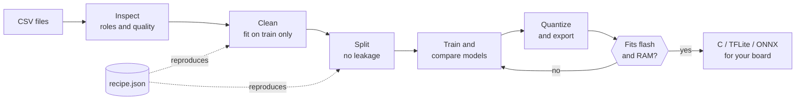
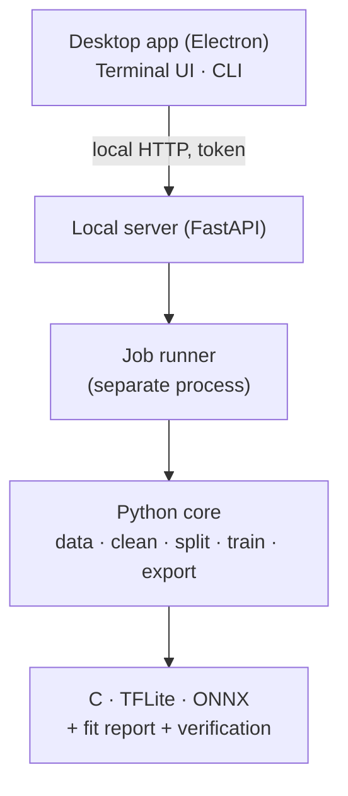

<div align="center">

<a href="../../README.md">English</a> · <a href="README.es.md">Español</a> · <a href="README.ja.md">日本語</a> · <a href="README.fr.md">Français</a> · <b>Português (Brasil)</b> · <a href="README.ko.md">한국어</a> · <a href="README.zh-CN.md">简体中文</a> · <a href="README.de.md">Deutsch</a> · <a href="README.it.md">Italiano</a> · <a href="README.ru.md">Русский</a>

# TinyML Studio

### Transforme dados de sensores em um modelo que cabe no seu microcontrolador.

<p>Limpe seus dados, treine e compare modelos, quantize e exporte C, TFLite ou ONNX, e confira se cabe na sua placa <b>antes</b> de gravar qualquer coisa.</p>

<p><i>Não se limita a um tipo de dado: Qualquer tabela de números serve (sensores, máquinas, ambiente, wearables, questionários). Os dois exemplos em hardware abaixo são apenas testes: Um é um questionário de estudantes, o outro usa leituras elétricas.</i></p>


<p><a href="#download">Baixar</a> · <a href="#quick-start">Início rápido</a> · <a href="#how">Como funciona</a> · <a href="#verified">Verificado em hardware</a> · <a href="#license">Licença</a></p>

</div>

> Pré-lançamento (v0.0.x). Verificada em PC (Windows 11 e Linux) e em uma ESP32-S3 com dois exemplos pequenos. Abaixo está o que foi e o que não foi verificado.

> 🌐 Esta tradução foi feita com ajuda de IA. Correções por pull request são bem-vindas.

<a id="why"></a>
## Por que existe
- Ir de um CSV a um microcontrolador costuma significar juntar notebooks, conversores e C escrito à mão, e descobrir no fim que não cabe ou que não se comporta como o modelo em Python.
- Aqui cada passo é salvo em uma receita JSON reproduzível, ajustada só com os dados de treino (sem vazamento), e o modelo exportado é comparado com o original.
- O app diz com clareza o que foi medido e o que é apenas estimativa.

<a id="how"></a>
## Como funciona
Sete passos guiados, dos seus arquivos CSV até o código que você cola no projeto da sua placa.



1. <b>Dataset</b>: Abra um ou vários CSV; o app verifica se podem ser misturados.
2. <b>Tarefa</b>: Escolha o que prever e o papel de cada coluna.
3. <b>Limpeza</b>: Valores ausentes e absurdos, escalonamento. Cada passo é ajustado só com o treino.
4. <b>Aumento</b> (opcional): Cria novas linhas de treino a partir das suas linhas reais. Por sua conta e risco.
5. <b>Partição</b>: Treino, validação e teste sem vazamento entre linhas vizinhas; balanceamento de classes opcional.
6. <b>Modelo e treinamento</b>: Compare modelos clássicos e redes pequenas nas mesmas partições.
7. <b>Placa e exportação</b>: Quantize, confira flash e RAM e obtenha código C, TFLite ou ONNX.

### Arquitetura
Um núcleo em Python faz o aprendizado de máquina, um pequeno servidor local o expõe e o app de desktop (Electron) é só a interface. A interface de terminal e a linha de comando usam o mesmo núcleo.



## Recursos
| | |
|---|---|
| **Dados** | Vários CSV, exportações do InfluxDB, vírgula decimal e latin-1. Avisa quando arquivos não deveriam ser misturados. |
| **Avaliação honesta** | Validação deixando uma sessão de fora, importância por permutação, rejeição de classes desconhecidas e detecção de anomalias. O teste é usado uma única vez. |
| **Modelos** | Modelos do scikit-learn, MLP e CNN 1D do Keras com TensorFlow ou PyTorch, benchmark com validação cruzada e busca dentro do seu orçamento de flash e RAM. |
| **Exportação verificada** | C independente para modelos clássicos, TFLite (float, int8, float16) e ONNX, sempre comparados com o modelo original. |
| **Placas** | Fichas de ESP32-S3 e outras ESP32, Arduino, Raspberry Pi e STM32, cada dado com sua fonte. |
| **Hardware** | Usa sua GPU NVIDIA ou AMD quando disponível, mostra carga e temperatura durante o treino, três interfaces (desktop, terminal, CLI). |

<a id="verified"></a>
## Verificado em hardware
Dois exemplos pequenos e reais foram executados de ponta a ponta em uma ESP32-S3. Mostram que o fluxo funciona; não são benchmarks.

| Exemplo | No computador | Na ESP32-S3 |
|---|---|---|
| Regressão: Nota de prova a partir de um questionário (dataset público, 6.607 linhas) | R² 0,943 no teste; o C gerado coincide com o scikit-learn em 100 % de 656 vetores | 6 de 6 casos do questionário coincidem com o Python (por exemplo 72,1 contra 72,12); 22 % da flash de programa |
| Classificação: Distinguir dois ventiladores domésticos com quatro leituras elétricas | F1 macro 1,000 no teste (duas gravações: Não prova generalização); o C coincide com o Python em 100 % dos vetores | 6 de 6 leituras estáveis ao vivo corretas; um transitório na troca de ventilador foi classificado errado |

<b>Não verificado:</b> Outras placas, latência e consumo medidos (os números de latência são estimativas), treino em GPU AMD, macOS, outros aparelhos ou outros dias no exemplo de classificação e os sketches Arduino em todas as versões da IDE.

<a id="download"></a>
## Baixar e executar
Os instaladores são publicados na página de <b>Releases</b>. Não é preciso Python nem Node.js para experimentar o app. Os instaladores do Windows não são assinados, então o SmartScreen pode avisar ("Mais informações" e depois "Executar mesmo assim").

| Plataforma | Arquivo |
|---|---|
| Windows 10 / 11 | Instalador <code>.exe</code> ou <code>.zip</code> |
| Linux | <code>.AppImage</code> ou <code>.deb</code> |

<a id="quick-start"></a>
### Compilar a partir do código-fonte
```bash
pip install -e ".[dev]"             # core + tests
python -m tinyml_studio.cli --help  # command line
cd ui && npm install && npm start   # desktop app (Python 3.10+, Node.js 20+)
```

## Documentação
Manual do usuário (PDF, em inglês, com capturas de tela): <a href="../manual/TinyML-Studio-User-Manual.pdf">docs/manual</a>.

## Como contribuir
Issues e pull requests são bem-vindos, principalmente validações em placas reais (informe placa, ferramentas e resultados), novas fichas de placas com fontes, traduções e novos exportadores. Execute <code>ruff check .</code> e <code>pytest</code> antes de abrir um pull request.

<a id="license"></a>
## Licença
Software livre sob a <b>GNU General Public License v3.0</b> (veja <a href="../../LICENSE">LICENSE</a>). Você pode usar, estudar, modificar e redistribuir; obras derivadas distribuídas devem continuar abertas sob a mesma licença. As dependências mantêm suas próprias licenças.

## Seus modelos e o código gerado
Os modelos que você treina e o código e os arquivos que o TinyML Studio gera para seus projetos (C, TFLite, ONNX, sketches Arduino) são seus. Você pode usá-los sob qualquer licença, inclusive em produtos fechados. A GPL-3.0 cobre o aplicativo, não o que você faz com ele.

## Créditos
Copyright © 2026 BrianGTRxx. Projetado e dirigido pelo autor e <b>desenvolvido com a ajuda do Claude</b> (Anthropic). Veja <a href="../../AUTHORS.md">AUTHORS.md</a>.
