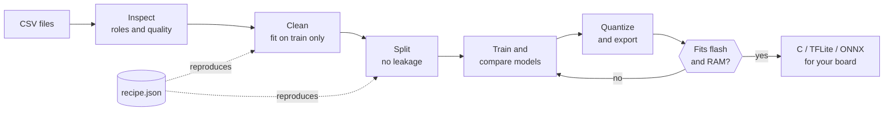
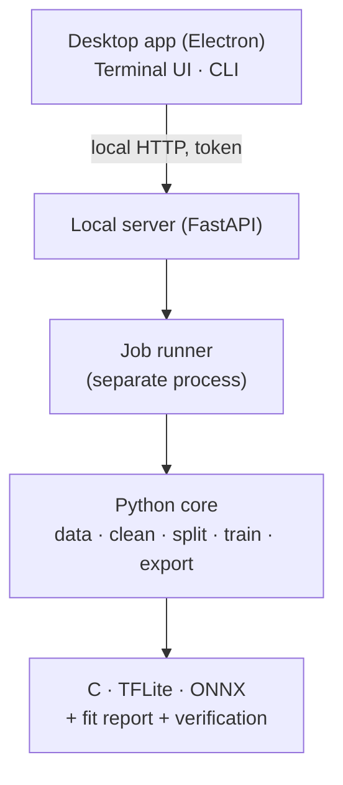

<div align="center">

<a href="../../README.md">English</a> · <a href="README.es.md">Español</a> · <a href="README.ja.md">日本語</a> · <a href="README.fr.md">Français</a> · <a href="README.pt-BR.md">Português (Brasil)</a> · <a href="README.ko.md">한국어</a> · <a href="README.zh-CN.md">简体中文</a> · <a href="README.de.md">Deutsch</a> · <a href="README.it.md">Italiano</a> · <b>Русский</b>

# TinyML Studio

### Превращает данные датчиков в модель, которая поместится в ваш микроконтроллер.

<p>Очищайте данные, обучайте и сравнивайте модели, квантуйте и экспортируйте в C, TFLite или ONNX и проверяйте, что результат помещается в вашу плату, <b>до</b> прошивки.</p>

<p><i>Она не ограничена одним типом данных: Подойдёт любая таблица чисел (датчики, машины, окружающая среда, носимые устройства, опросы). Два примера на железе ниже это всего лишь тесты: Один основан на опросе учеников, другой на электрических измерениях.</i></p>


<p><a href="#download">Скачать</a> · <a href="#quick-start">Быстрый старт</a> · <a href="#how">Как это работает</a> · <a href="#verified">Проверено на железе</a> · <a href="#license">Лицензия</a></p>

</div>

> Предварительная версия (v0.0.x). Проверена на ПК (Windows 11 и Linux) и на ESP32-S3 на двух небольших примерах. Что проверено, а что нет, описано ниже.

> 🌐 Этот перевод выполнен с помощью ИИ. Исправления через pull request приветствуются.

<a id="why"></a>
## Зачем это нужно
- Путь от CSV до микроконтроллера обычно означает склейку ноутбуков, конвертеров и вручную написанного C, а в конце выясняется, что модель не помещается или ведёт себя иначе, чем модель на Python.
- Здесь каждый шаг сохраняется в воспроизводимом JSON-рецепте, подгоняется только по обучающим данным (без утечки), а экспортированная модель сравнивается с оригиналом.
- Приложение прямо говорит, что было измерено, а что является лишь оценкой.

<a id="how"></a>
## Как это работает
Семь шагов с подсказками: От ваших CSV-файлов до кода, который можно вставить в проект платы.



1. <b>Набор данных</b>: Откройте один или несколько CSV; приложение проверит, можно ли их объединять.
2. <b>Задача</b>: Выберите, что предсказывать, и роль каждого столбца.
3. <b>Очистка</b>: Пропущенные и абсурдные значения, масштабирование. Каждый шаг подгоняется только по обучающей выборке.
4. <b>Аугментация</b> (необязательно): Создание новых обучающих строк из ваших реальных строк. На вашу ответственность.
5. <b>Разбиение</b>: Обучение, валидация и тест без утечки между соседними строками; по желанию балансировка классов.
6. <b>Модель и обучение</b>: Сравнение классических моделей и небольших сетей на одинаковых разбиениях.
7. <b>Плата и экспорт</b>: Квантование, проверка флеш-памяти и ОЗУ, получение кода C, TFLite или ONNX.

### Архитектура
Ядро на Python выполняет машинное обучение, небольшой локальный сервер предоставляет к нему доступ, а настольное приложение (Electron) является только интерфейсом. Терминальный интерфейс и командная строка используют то же ядро.



## Возможности
| | |
|---|---|
| **Данные** | Несколько CSV, выгрузки InfluxDB, десятичная запятая и latin-1. Предупреждает, если файлы не стоит смешивать. |
| **Честная оценка** | Валидация с исключением сессии, важность признаков перестановкой, отклонение неизвестных классов и поиск аномалий. Тестовая выборка используется один раз. |
| **Модели** | Модели scikit-learn, Keras MLP и 1D-CNN на TensorFlow или PyTorch, бенчмарк с кросс-валидацией и поиск в пределах вашего бюджета флеш-памяти и ОЗУ. |
| **Проверенный экспорт** | Автономный C для классических моделей, TFLite (float, int8, float16) и ONNX; результат всегда сверяется с исходной моделью. |
| **Платы** | Карточки ESP32-S3 и других ESP32, Arduino, Raspberry Pi и STM32; у каждого поля указан источник. |
| **Оборудование** | Использует видеокарту NVIDIA или AMD, если она доступна, показывает нагрузку и температуру при обучении; три интерфейса (настольный, терминал, CLI). |

## Что можно обучить и экспортировать
Обучение с учителем (классификация и регрессия) и обнаружение аномалий без учителя. Приложение предлагает задачу по вашим столбцам, а вы её подтверждаете.

| | |
|---|---|
| **Задачи** | Классификация и регрессия, обнаружение аномалий без меток (Isolation Forest, One-Class SVM), обученное только на нормальных данных, и отклонение неизвестного класса, чтобы модель могла ответить «не знаю». Кластеризации нет. |
| **Модели** | Классические: Решающее дерево, random forest, extra trees, градиентный бустинг, логистическая и линейная регрессия, Lasso, Elastic Net, LDA, линейный SVM, SVM и SVR, k-NN, гауссовский наивный Байес, MLP. Нейросети: MLP на Keras и 1D-CNN по окнам из последовательных строк, с бэкендом TensorFlow или PyTorch. |
| **Очистка и аугментация** | Заполнение пропусков, абсурдные значения, выбросы (IQR или z-score), масштабирование (стандартное, min-max, устойчивое), дубликаты и фильтры. Необязательная аугментация обучающих строк гауссовским шумом или интерполяцией в духе SMOTE. Всё подбирается только по train. |
| **Разбиение и оценка** | Случайное, стратифицированное, по группам или по временным блокам, с необязательной балансировкой классов. Бенчмарк с кросс-валидацией, поиск гиперпараметров в рамках вашего бюджета flash и RAM, перестановочная важность признаков. Тестовая выборка используется один раз. |
| **Экспорт** | C99 без зависимостей (линейные модели, деревья и леса, SVM, MLP, наивный Байес и компактная раскладка для лесов), TFLite (float, int8, float16), ONNX и скетчи Arduino. Не каждая модель экспортируется во все форматы: Приложение показывает, какие можно. |
| **Проверки** | Отчёт о flash и RAM для каждой платы, сравнение Keras, TFLite и int8, а также тестовые векторы, сверяющие C-код с Python. Задержка является оценкой, а не измерением. |

<a id="verified"></a>
## Проверено на железе
Два небольших реальных примера были пройдены от начала до конца на ESP32-S3. Они показывают, что цепочка работает; это не бенчмарки.

| Пример | На компьютере | На ESP32-S3 |
|---|---|---|
| Регрессия: Оценка за экзамен по анкете (открытый набор данных, 6 607 строк) | R² 0,943 на отложенном тесте; сгенерированный C совпадает со scikit-learn на 100 % из 656 тестовых векторов | 6 из 6 случаев анкеты совпали с Python (например, 72,1 против 72,12); 22 % флеш-памяти программы |
| Классификация: Различить два бытовых вентилятора по четырём электрическим измерениям | F1 macro 1,000 на тесте (две записи, поэтому это не доказательство обобщения); C совпадает с Python на 100 % векторов | 6 из 6 устойчивых измерений вживую верны; переходный режим при смене вентилятора классифицирован неверно |

<b>Не проверено:</b> Другие платы, измеренные задержка и потребление (цифры задержки это оценки), обучение на GPU AMD, macOS, другие приборы или другие дни в примере классификации, а также сгенерированные скетчи Arduino во всех версиях IDE.

<a id="download"></a>
## Скачать и запустить
Установщики публикуются на странице <b>Releases</b>. Чтобы попробовать приложение, Python и Node.js не нужны. Установщики для Windows не подписаны, поэтому SmartScreen может предупредить (нажмите «Подробнее», затем «Выполнить в любом случае»).

| Платформа | Файл |
|---|---|
| Windows 10 / 11 | Установщик <code>.exe</code> или <code>.zip</code> |
| Linux | <code>.AppImage</code> или <code>.deb</code> |

<a id="quick-start"></a>
### Сборка из исходников
```bash
pip install -e ".[dev]"             # core + tests
python -m tinyml_studio.cli --help  # command line
cd ui && npm install && npm start   # desktop app (Python 3.10+, Node.js 20+)
```

## Документация
Руководство пользователя (PDF, на английском, со скриншотами): <a href="../manual/TinyML-Studio-User-Manual.pdf">docs/manual</a>.

## Участие в проекте
Приветствуются issue и pull request, особенно проверки на реальных платах (укажите плату, инструменты и результаты), новые карточки плат с источниками, переводы и новые экспортёры. Перед pull request запустите <code>ruff check .</code> и <code>pytest</code>.

<a id="license"></a>
## Лицензия
Свободное программное обеспечение под лицензией <b>GNU General Public License v3.0</b> (см. <a href="../../LICENSE">LICENSE</a>). Вы можете использовать, изучать, изменять и распространять его; распространяемые производные работы должны оставаться открытыми на тех же условиях. Зависимости сохраняют свои лицензии.

## Ваши модели и сгенерированный код
Модели, которые вы обучаете, а также код и файлы, которые TinyML Studio создаёт для ваших проектов (C, TFLite, ONNX, скетчи Arduino), принадлежат вам. Вы можете использовать их под любой лицензией, в том числе в закрытых продуктах. GPL-3.0 распространяется на само приложение, а не на то, что вы с его помощью создаёте.

## Авторство
Copyright © 2026 BrianGTRxx. Разработано под руководством автора <b>при помощи Claude</b> (Anthropic). См. <a href="../../AUTHORS.md">AUTHORS.md</a>.
