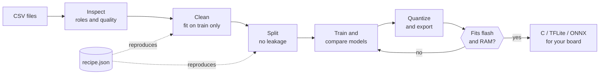
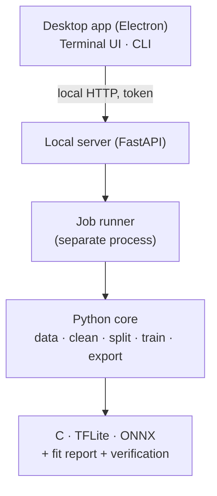

<div align="center">

<a href="../../README.md">English</a> · <a href="README.es.md">Español</a> · <a href="README.ja.md">日本語</a> · <a href="README.fr.md">Français</a> · <a href="README.pt-BR.md">Português (Brasil)</a> · <a href="README.ko.md">한국어</a> · <b>简体中文</b> · <a href="README.de.md">Deutsch</a> · <a href="README.it.md">Italiano</a> · <a href="README.ru.md">Русский</a>

# TinyML Studio

### 把传感器数据变成能装进微控制器的模型。

<p>清洗数据、训练并比较模型、量化并导出 C、TFLite 或 ONNX,并在烧录之<b>前</b>确认它能放进你的开发板。</p>

<p><i>它不局限于某一类数据:任何数字表格都可以使用 (传感器、机器、环境、可穿戴设备、问卷等)。下面两个硬件示例只是测试:一个是学生问卷,另一个使用电学读数。</i></p>


<p><a href="#download">下载</a> · <a href="#quick-start">快速开始</a> · <a href="#how">工作原理</a> · <a href="#verified">硬件实测</a> · <a href="#license">许可证</a></p>

</div>

> 预发布版本 (v0.0.x)。已在电脑 (Windows 11 和 Linux) 上验证,并用两个小示例在 ESP32-S3 上验证。下文列出了已验证和未验证的内容。

> 🌐 本翻译在 AI 协助下完成,欢迎通过 Pull Request 指正。

<a id="why"></a>
## 为什么做它
- 从 CSV 走到微控制器,往往要把 notebook、转换工具和手写 C 代码拼在一起,到最后才发现放不下,或者行为和 Python 模型不一样。
- 这里的每一步都保存为可复现的 JSON 配方,只用训练数据拟合 (没有数据泄漏),导出的模型会与原模型对比。
- 应用会明确告诉你哪些是实测、哪些只是估计。

<a id="how"></a>
## 工作原理
七个引导步骤,从 CSV 文件一直到可以粘贴进开发板工程的代码。



1. <b>数据集</b>:打开一个或多个 CSV,应用会检查它们能否合并。
2. <b>任务</b>:选择预测目标和每一列的角色。
3. <b>清洗</b>:缺失值和异常值、缩放。每一步都只用训练集拟合。
4. <b>增强</b> (可选):根据真实数据行生成新的训练行。风险自负。
5. <b>划分</b>:划分训练、验证和测试集,避免相邻行泄漏;可选类别平衡。
6. <b>模型与训练</b>:在相同划分上比较经典模型和小型神经网络。
7. <b>开发板与导出</b>:量化、检查 Flash 和 RAM,并获得 C 代码、TFLite 或 ONNX。

### 架构
机器学习由 Python 核心完成,一个小型本地服务器对外提供接口,桌面应用 (Electron) 只负责界面。终端界面和命令行使用同一个核心。



## 功能
| | |
|---|---|
| **数据** | 支持多个 CSV、InfluxDB 导出、小数逗号和 latin-1。不该合并的文件会给出警告。 |
| **诚实的评估** | 按会话留一验证、置换重要性、未知类别拒识和异常检测。测试集只用一次。 |
| **模型** | scikit-learn 模型,基于 TensorFlow 或 PyTorch 的 Keras MLP 和 1D-CNN,带交叉验证的基准测试,以及在你的 Flash 和 RAM 预算内的搜索。 |
| **经过验证的导出** | 经典模型导出独立的 C 代码,另有 TFLite (float、int8、float16) 和 ONNX,始终与原模型比对。 |
| **开发板** | ESP32-S3 及其他 ESP32、Arduino、Raspberry Pi 和 STM32 的板卡资料,每个字段都注明来源。 |
| **硬件** | 有 NVIDIA 或 AMD GPU 时自动使用,训练时显示负载和温度,提供桌面、终端和命令行三种界面。 |

## 可以训练和导出什么
支持监督学习（分类和回归）以及无监督异常检测。应用会根据你的列建议任务，由你确认。

| | |
|---|---|
| **任务** | 分类和回归；只用正常数据训练的无标签异常检测（Isolation Forest、One-Class SVM）；以及让模型可以回答“不知道”的未知类别拒识。不包含聚类。 |
| **模型** | 经典模型: 决策树、随机森林、Extra Trees、梯度提升、逻辑回归和线性回归、Lasso、Elastic Net、LDA、线性 SVM、SVM 和 SVR、k-NN、高斯朴素贝叶斯、MLP。神经网络: Keras MLP，以及作用于连续行窗口的 1D-CNN（TensorFlow 或 PyTorch 后端）。 |
| **清洗与增强** | 缺失值填补、荒谬值、异常值（IQR 或 z-score）、缩放（标准、min-max、稳健）、重复项和过滤。可选的训练行增强：高斯噪声或 SMOTE 式插值。所有步骤只用训练集拟合。 |
| **划分与评估** | 随机、分层、按分组或时间块划分，可选类别平衡。交叉验证基准测试、在 flash 和 RAM 预算内搜索超参数、排列重要性。测试集只使用一次。 |
| **导出** | 无依赖的 C99（线性模型、树和森林、SVM、MLP、朴素贝叶斯，以及森林的紧凑布局）、TFLite（float、int8、float16）、ONNX 和 Arduino 示例代码。并非每个模型都能导出为所有格式，应用会告诉你哪些可以。 |
| **校验** | 每块开发板的 flash 和 RAM 报告、Keras 与 TFLite 与 int8 的对比，以及把 C 代码与 Python 对照的测试向量。延迟是估计值，不是实测值。 |

<a id="verified"></a>
## 硬件实测
两个真实的小示例已在 ESP32-S3 上完整跑通。它们说明整条流程可用,但不是基准测试。

| 示例 | 在电脑上 | 在 ESP32-S3 上 |
|---|---|---|
| 回归:根据学生问卷预测考试成绩 (公开数据集,6,607 行) | 留出测试集 R² 为 0.943;生成的 C 代码在 656 个测试向量上 100 % 与 scikit-learn 一致 | 6 个问卷案例全部与 Python 一致 (例如 72.1 对 72.12);占用程序 Flash 的 22 % |
| 分类:用四个电学读数区分两台家用风扇 | 测试集 F1 macro 为 1.000 (只有两段录音,不能证明泛化能力);C 代码在全部向量上与 Python 一致 | 6 次稳定的实时读数全部正确;切换风扇时的瞬态被误分类 |

<b>未验证:</b>其他开发板、实测的延迟和功耗 (延迟数字是估计值)、AMD GPU 训练、macOS、分类示例中的其他电器或其他日期,以及在所有 Arduino IDE 版本中生成的草图。

<a id="download"></a>
## 下载与运行
安装包发布在 <b>Releases</b> 页面。试用无需安装 Python 或 Node.js。Windows 安装包未签名,SmartScreen 可能会提示 (点击“更多信息”,再点“仍要运行”)。

| 平台 | 文件 |
|---|---|
| Windows 10 / 11 | 安装程序 <code>.exe</code> 或 <code>.zip</code> |
| Linux | <code>.AppImage</code> 或 <code>.deb</code> |

<a id="quick-start"></a>
### 从源码构建
```bash
pip install -e ".[dev]"             # core + tests
python -m tinyml_studio.cli --help  # command line
cd ui && npm install && npm start   # desktop app (Python 3.10+, Node.js 20+)
```

## 文档
用户手册 (PDF,英文,含截图):<a href="../manual/TinyML-Studio-User-Manual.pdf">docs/manual</a>。

## 参与贡献
欢迎提交 Issue 和 Pull Request,尤其是真实开发板上的验证 (请注明开发板、工具链和结果)、带来源的新板卡资料、翻译和新的导出器。提交前请运行 <code>ruff check .</code> 和 <code>pytest</code>。

<a id="license"></a>
## 许可证
自由软件,采用 <b>GNU General Public License v3.0</b> (见 <a href="../../LICENSE">LICENSE</a>)。你可以使用、研究、修改和再分发;分发的衍生作品必须以相同许可证保持开源。依赖项保留各自的许可证。

## 你的模型和生成的代码
你训练的模型,以及 TinyML Studio 为你的项目生成的代码和文件 (C、TFLite、ONNX、Arduino 草图) 都属于你。你可以用任何许可证使用它们,包括闭源产品。GPL-3.0 约束的是应用程序本身,而不是你用它做出的成果。

## 致谢
Copyright © 2026 BrianGTRxx。由作者设计和主导,并在 <b>Claude (Anthropic) 的协助下开发</b>。见 <a href="../../AUTHORS.md">AUTHORS.md</a>。
